# Sonata 2

**Everything you love about a Mac. And a lot it can't do.**

Sonata is a complete desktop for Linux: menu bar, Dock, Control Center,
Files, Settings and a dozen apps, all made to work together, beautiful from
the first minute. Then it goes further, with folders in the Dock, apps you
can lock, hide or open in a sandbox, video wallpapers and a look you can
make truly yours. Free and open source.

**[Website](https://vinioliveiras.github.io/Sonata2/)** ·
**[Install](#install)** · **[Full guide](docs/GUIDE.md)** ·
**[Changelog](CHANGELOG.md)** · **[Donate](https://ko-fi.com/vinioliveira)**

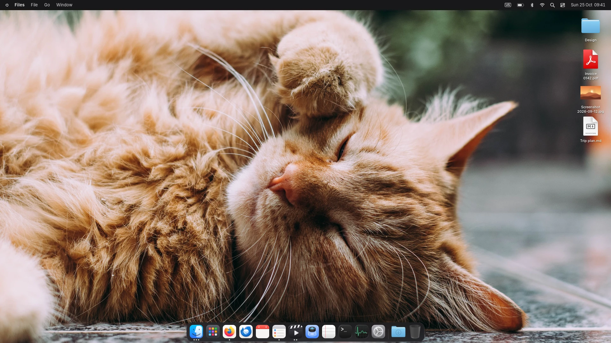

## Things your Mac can't do

Built in, no extensions, and they work with every app you install.

| | |
|---|---|
| 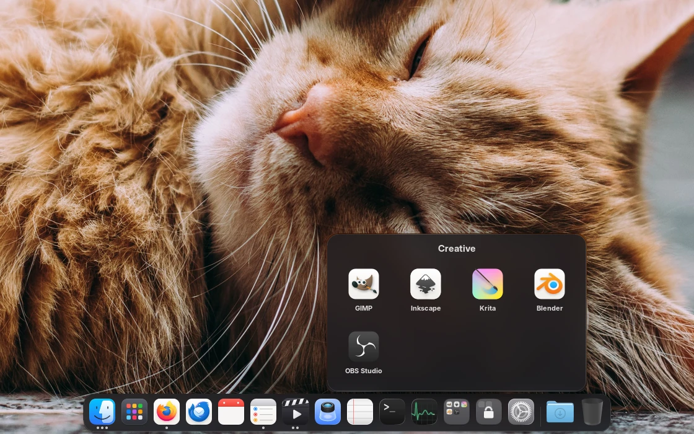 | **Folders in the Dock.** Group apps into folders right in the Dock, like on your phone. Drag any folder from Files there too and it stays as a stack. |
| 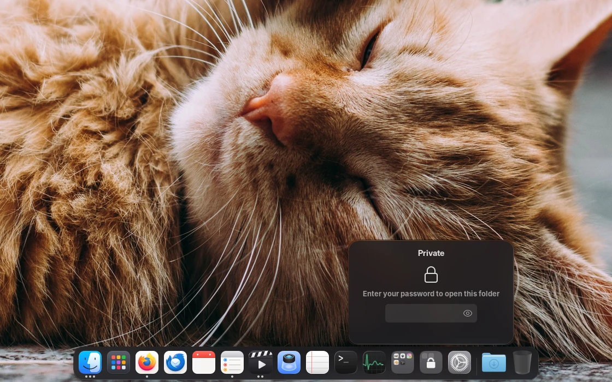 | **Lock any app or folder.** Locked ones ask for your password every time they open; nothing of what's inside shows on the icon. |
| 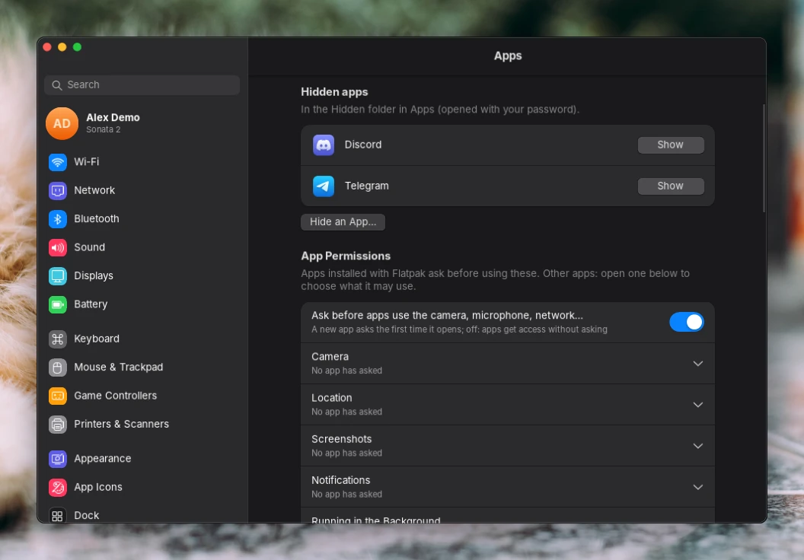 | **Hide apps, and choose what they can use.** Hidden apps leave Apps, Search and the Dock; only your password brings them back. New Flatpak apps ask before they use the camera, microphone, network or your files. |
| 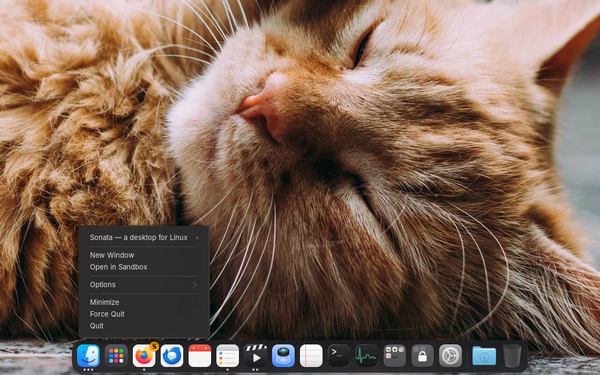 | **Open any app in a sandbox.** An empty home of its own: none of your files, sign-ins or settings, and nothing it does is kept when it closes. |
| 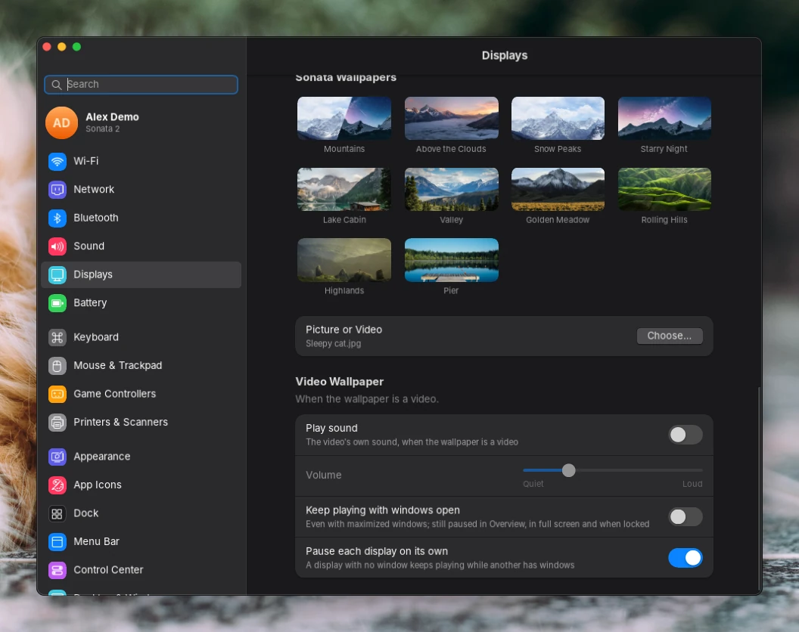 | **Video wallpapers, done right.** A smooth loop, optional sound, paused under windows, in games and on each display on its own, and blurred on the lock and login screens. |
| 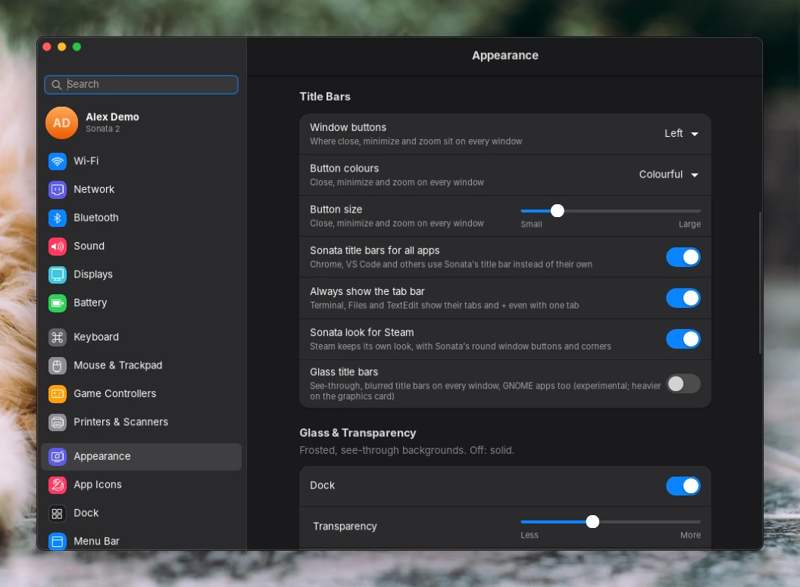 | **Make every window yours.** Window buttons on either side, in any size and colour; corners, glass, any accent from a colour wheel, a tinted background, and the same look in Chrome, VS Code and Steam. |

And more:

- **Windows shortcuts too**: Alt+Tab, Super+D, Win+V clipboard history, next to the Mac ones.
- **A controller as your mouse**: use the desktop from the couch with any Xbox, PlayStation or 8BitDo pad.
- **Made for games**: full speed while you play, a frame-rate limit, and the strong graphics card picked for you.
- **A Control Center you arrange**: add CPU, GPU, memory, network, FPS or a volume mixer.
- **Never frozen by one app**: an app that runs the memory out is closed; the desktop carries on.
- **Locked means locked**: with USB protection on, new USB devices stay blocked while the screen is locked.

## Everything you need, ready on day one

| | |
|---|---|
| 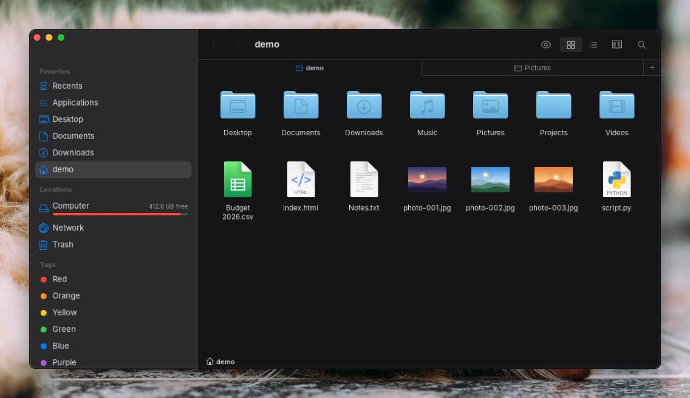<br>**Files**: tabs, quick previews, every disk mounted | 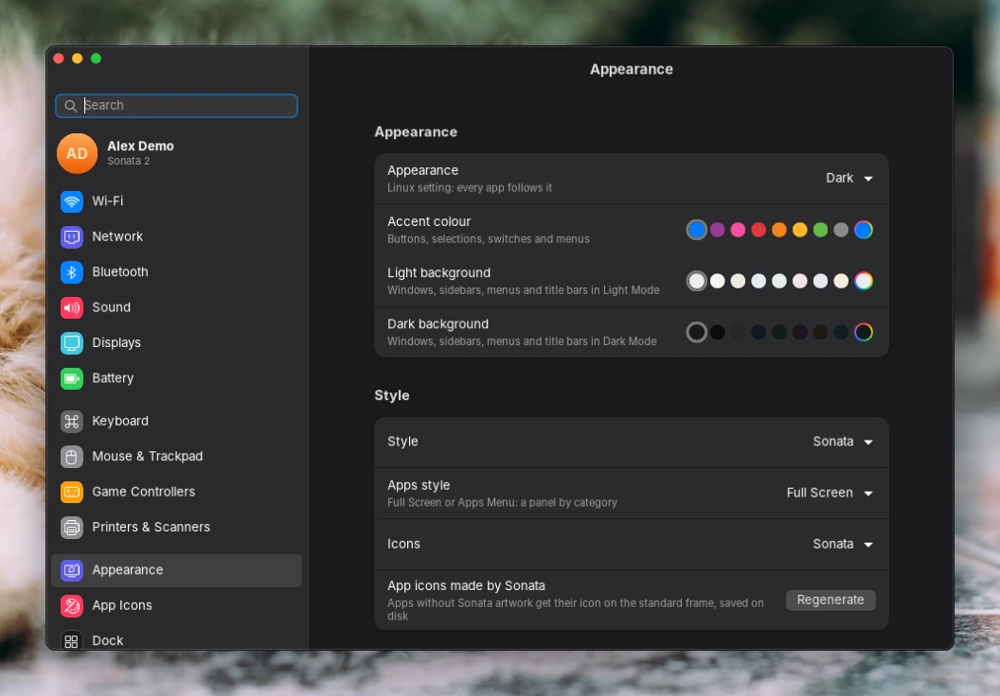<br>**Settings**: your computer and your desktop in one place |
| 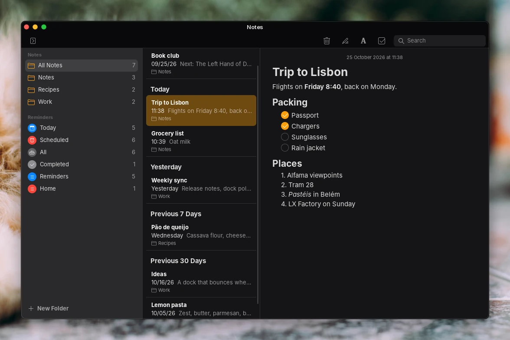<br>**Notes** and **Reminders** | 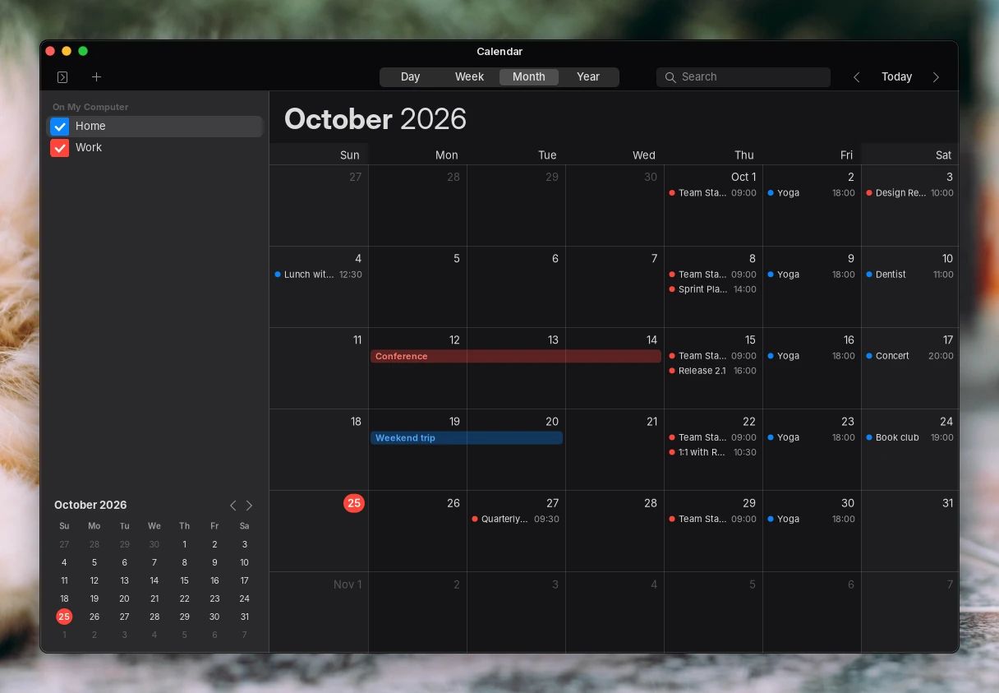<br>**Calendar** |
| 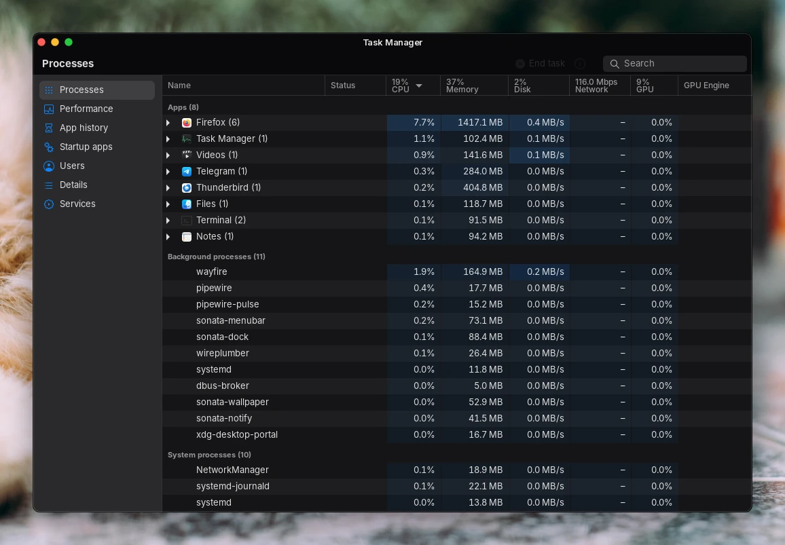<br>**Task Manager**: every process, and which graphics card it uses | 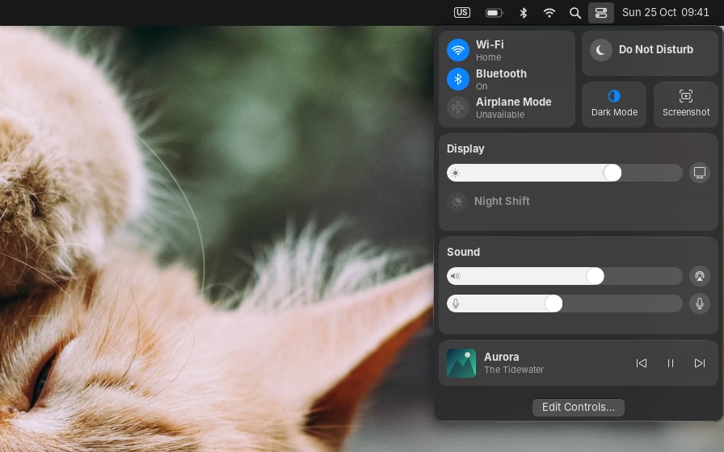<br>**Control Center** |

Also TextEdit, Preview, Terminal, Disk Utility, Calculator, Camera, Clock,
web apps, a login and lock screen, Launchpad and Search.

<sub>Screenshots use invented demo data; `tools/readme-shots.py` makes them.</sub>

## Install

```
git clone https://github.com/vinioliveiras/sonata2.git && cd sonata2
./install.sh
```

Then log out and pick **Sonata** on the login screen. The installer takes
care of the dependencies on Arch, Fedora, openSUSE, Debian, Ubuntu 25.10+,
Void and Alpine; the [full guide](docs/GUIDE.md#install) has the options,
the distributions it runs on, troubleshooting and development.

## License

Sonata is free software: you can use, study, change and share it under the
[GNU General Public License v3.0 or later](LICENSE). Copyright 2026 Vini.
Anyone who shares Sonata, or a version they changed, must share its source
under the same license: it stays free.

These parts of the repository are other people's work and keep their own
licenses (they are GPL-compatible):

| Path | What | License |
|---|---|---|
| `sonata2/data/icons/Sonata-MacTahoe/` | MacTahoe icon theme | GPL-3.0 (its `COPYING`) |
| `sonata2/data/icons/Sonata/places/scalable/user-trash*.svg` | WhiteSur trash icons | GPL-3.0 |
| `sonata2/data/icons/Sonata-Cursors/` | apple_cursor | GPL-3.0 (`LICENSE-apple_cursor`) |
| `sonata2/data/themes/` (WhiteSur parts) | WhiteSur GTK theme | MIT (`LICENSE-WhiteSur`) |
| `sonata2/data/fonts/` | Inter | SIL OFL 1.1 (`LICENSE-Inter.txt`) |
| `sonata2/data/avatars/` | Noto Color Emoji on the stock pictures | Apache-2.0 / OFL 1.1 (`LICENSE.txt`) |
| `sonata2/data/wallpapers/` | Photos from Unsplash | Unsplash License (`LICENSE.md`) |
